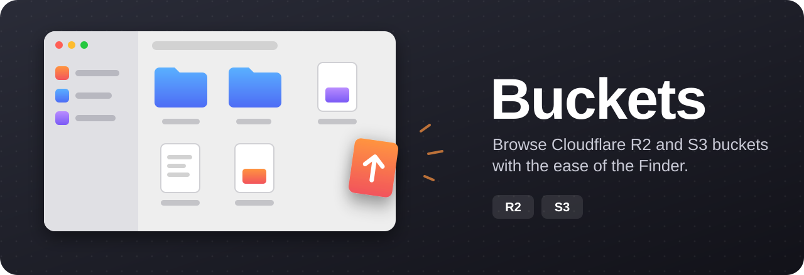
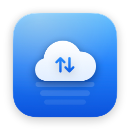
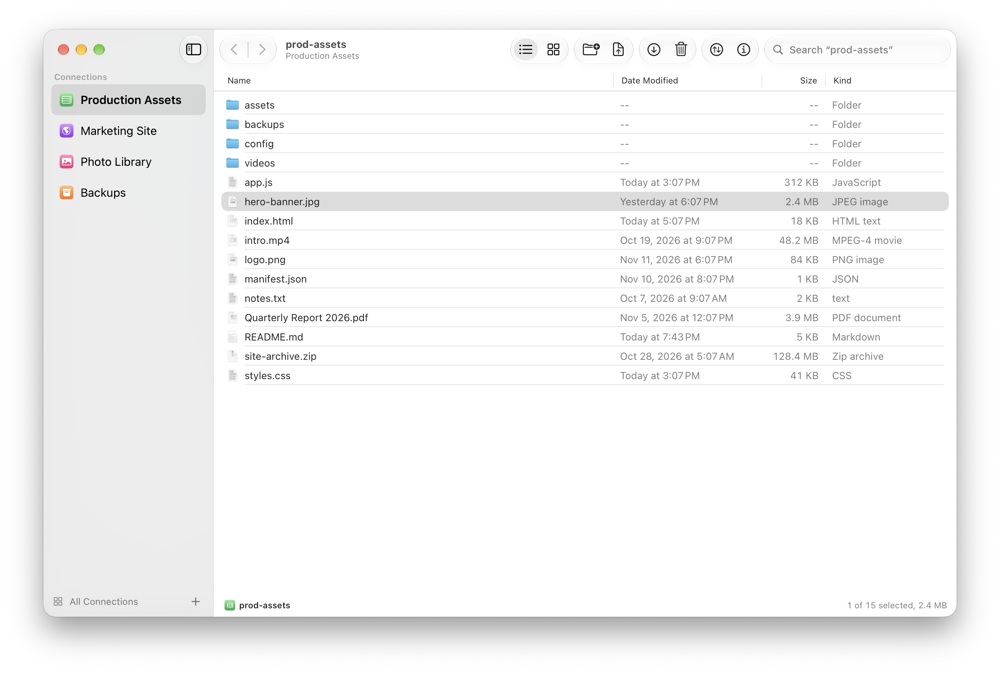
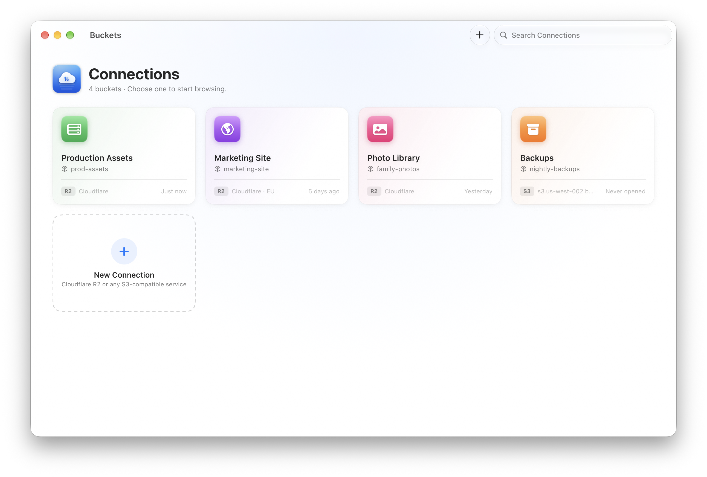
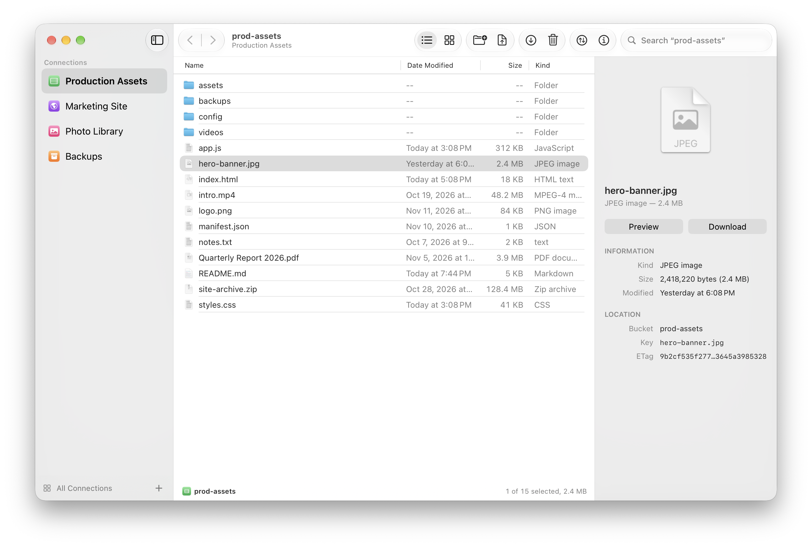
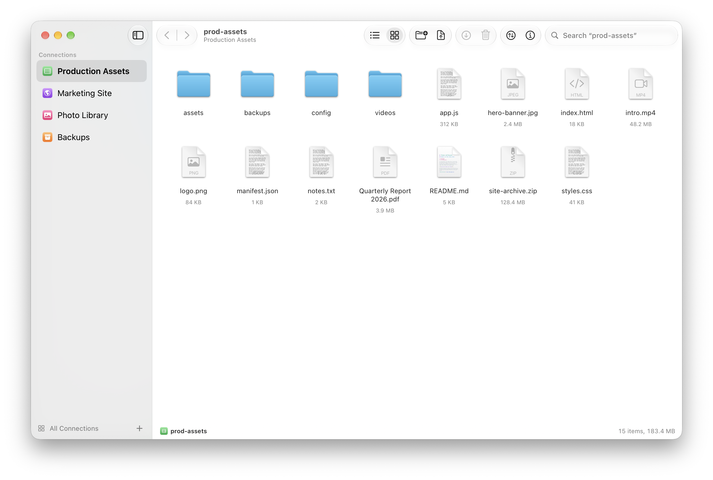
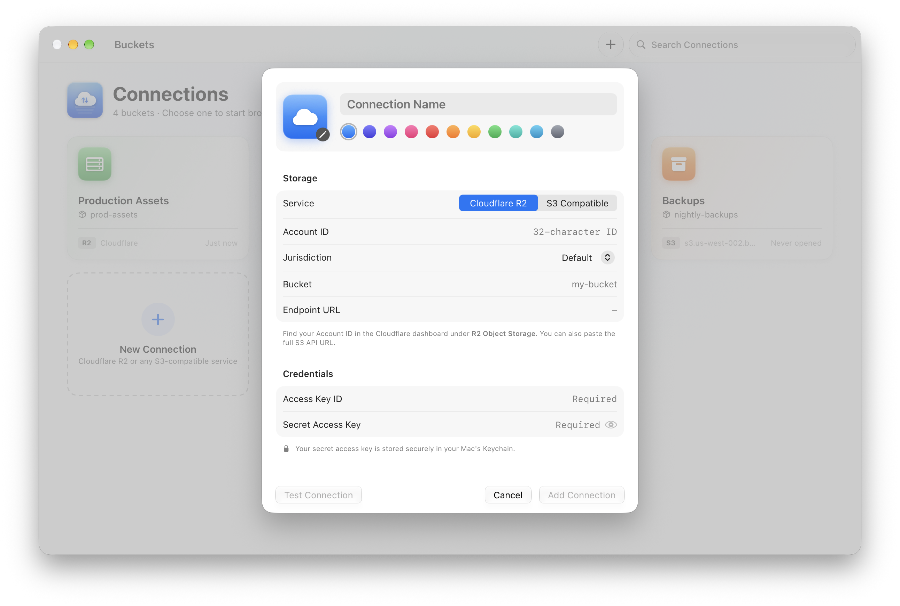

<p align="center">
  
</p>

<p align="center">
  <br>
  <b>A native macOS app for Cloudflare R2 and S3-compatible storage.</b><br>
  Browse, upload, download, rename and edit files in your buckets, like folders in the Finder.
</p>

<p align="center">
  <a href="https://github.com/sponsors/zacksmash"></a>
  
  
</p>

---

## What it does

Save a **connection** for each bucket, then open it in a Finder-style browser. Buckets is built in SwiftUI with macOS 26's Liquid Glass. Screenshots follow your light or dark setting.

<p align="center">
  <picture><source media="(prefers-color-scheme: dark)" srcset="docs/screenshots/dark-list.png"></picture>
</p>

- **Connections**: as many as you like, each with its own credentials, name, color and icon. Secret keys live in the Keychain.
- **List and icon views**, a path bar, an inspector and Quick Look.
- **Drag and drop** files and folders from the Finder to upload them. Large files upload in parts.
- **Create folders**, rename, delete, download and copy paths.
- **Edit text files** in place and save them back to the bucket.

<p align="center">
  <picture><source media="(prefers-color-scheme: dark)" srcset="docs/screenshots/dark-home.png"></picture>
  <picture><source media="(prefers-color-scheme: dark)" srcset="docs/screenshots/dark-inspector.png"></picture>
</p>
<p align="center">
  <picture><source media="(prefers-color-scheme: dark)" srcset="docs/screenshots/dark-icons.png"></picture>
</p>

## Install

> [!WARNING]
> **Buckets isn't signed with a paid Apple Developer account**, so it isn't notarized by Apple. That's a $99/year membership, and Buckets is a free side project.
>
> - **Building from source** (below) is the easiest way: an app you build yourself isn't flagged by Gatekeeper.
> - **If you download a pre-built copy** from [Releases](https://github.com/zacksmash/buckets-mac/releases/latest), macOS will refuse to open it the first time. Go to **System Settings → Privacy & Security** and click **Open Anyway**, or clear the download flag once:
>   ```bash
>   xattr -dr com.apple.quarantine /Applications/Buckets.app
>   ```
>
> Release builds are signed ad hoc, so after an update macOS may ask once more before Buckets can read its keys from the Keychain. Click **Always Allow** and it won't ask again until the next update.
>
> If Buckets earns a spot in your day and you'd like it to open without any of this, [**sponsoring me on GitHub**](https://github.com/sponsors/zacksmash) goes straight toward the developer account that makes notarized releases possible. 💛

### Build from source

You need macOS 26 or later and Xcode 26 or later.

```bash
git clone https://github.com/zacksmash/buckets-mac.git
cd buckets-mac
Scripts/build-app.sh            # builds build/Buckets.app
cp -R build/Buckets.app /Applications/
open /Applications/Buckets.app
```

The script compiles a release build, renders the app icon and signs the app ad hoc. If you have a signing certificate, set `SIGN_IDENTITY` (for example `SIGN_IDENTITY="Developer ID Application: …" Scripts/build-app.sh`) to sign with it and the hardened runtime instead. For development, `open Package.swift` in Xcode and run the `Buckets` scheme, or use `swift run`.

## Usage

<p align="center">
  <picture><source media="(prefers-color-scheme: dark)" srcset="docs/screenshots/dark-editor.png"></picture>
</p>

### Connections

1. Click **Add Your First Connection**, or **File → New Connection…** (<kbd>⌘</kbd><kbd>N</kbd>).
2. Pick a **Service**: **Cloudflare R2** or **S3 Compatible**.
   - **R2**: enter your **Account ID** (find it in the Cloudflare dashboard under **R2 Object Storage**, or paste the full S3 API URL) and pick a **Jurisdiction** (Default, EU or FedRAMP).
   - **S3 Compatible**: enter the endpoint URL and region.
3. Enter the **Bucket**, **Access Key ID** and **Secret Access Key**.
4. Click **Test Connection**, then **Save**.

The secret key is stored in your Mac's Keychain. Everything else is saved in `~/Library/Application Support/Buckets/connections.json`. Deleting a connection removes both from this Mac. Files in the bucket aren't affected.

### Browsing

| Shortcut | Does |
| --- | --- |
| <kbd>⌘</kbd><kbd>1</kbd> / <kbd>⌘</kbd><kbd>2</kbd> | List or icon view |
| <kbd>⌘</kbd><kbd>[</kbd> / <kbd>⌘</kbd><kbd>]</kbd> | Back / forward |
| <kbd>⌘</kbd><kbd>↑</kbd> | Enclosing folder |
| <kbd>⇧</kbd><kbd>⌘</kbd><kbd>H</kbd> | Bucket root |
| <kbd>⇧</kbd><kbd>⌘</kbd><kbd>0</kbd> | All connections |
| <kbd>⌘</kbd><kbd>R</kbd> | Refresh |
| <kbd>⇧</kbd><kbd>⌘</kbd><kbd>N</kbd> | New folder |
| <kbd>⌘</kbd><kbd>U</kbd> | Upload files |
| <kbd>⌥</kbd><kbd>⌘</kbd><kbd>D</kbd> | Download selection |
| <kbd>⌥</kbd><kbd>⌘</kbd><kbd>C</kbd> | Copy path |
| <kbd>⌥</kbd><kbd>⌘</kbd><kbd>N</kbd> | New window |

- **Upload**: drag files or folders from the Finder onto the browser. They go into the folder you're in.
- **Right-click** an item to open, Quick Look, download, rename, copy its path or delete it.
- **Edit**: text files open in an editor. <kbd>⌘</kbd><kbd>S</kbd> saves back to the bucket. **File → New Text File…** creates one.
- **Transfers**: uploads and downloads show progress in the toolbar's transfers popover.
- **Open in New Window** to browse two folders or buckets side by side.

## Good to know

- Buckets talks to the S3 API directly, with its own request signing. No SDKs or other dependencies.
- Deleting from the bucket is permanent. Buckets asks first.
- Files over 100 MB upload in parts.
- Needs macOS 26 or later.

## Support

Buckets is free and built in spare time. If it saves you a trip to the Cloudflare dashboard:

<p align="center">
  <a href="https://github.com/sponsors/zacksmash"><b>❤️ Sponsor @zacksmash on GitHub</b></a>
</p>

Sponsorships help cover an Apple Developer account, so future releases can be signed and notarized and open with a double-click. Bug reports and ideas are welcome in [Issues](https://github.com/zacksmash/buckets-mac/issues).

## License

[MIT](LICENSE) © Zack Warren
